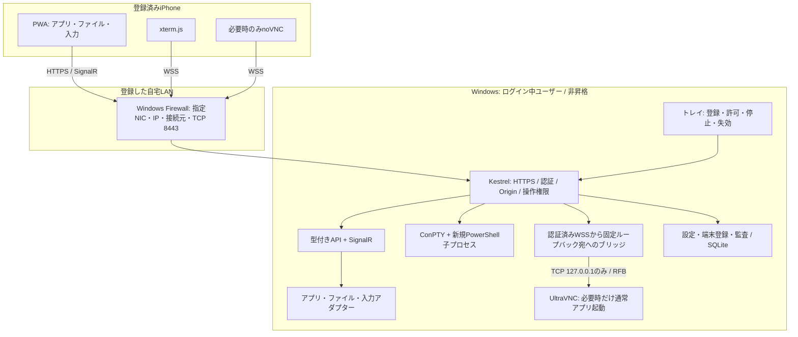
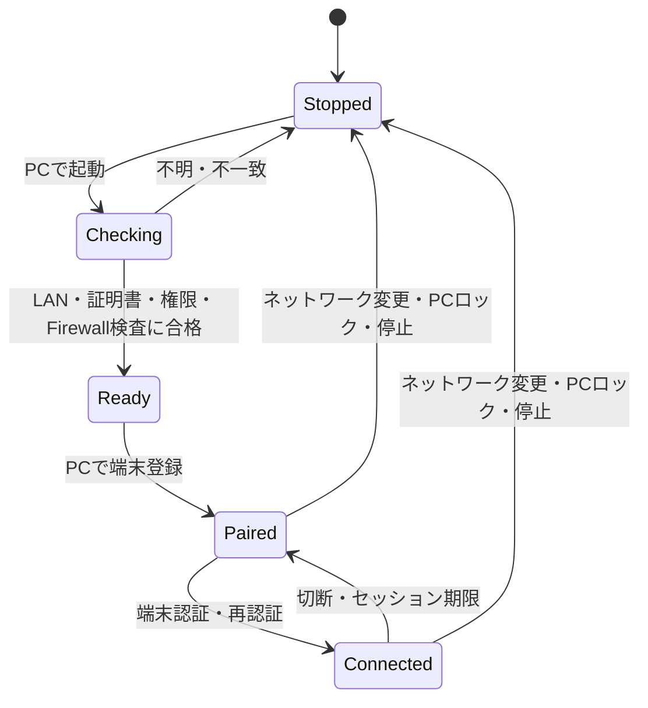

# アーキテクチャ案

## 構成と信頼境界

インターネット側の入口は作らない。8443は設計上の例で、PCで競合を確認して1つに固定する。VNCの5900等はLANから受けない。アプリはブラウザ用静的ファイルも同じHTTPSオリジンから配信し、CDN・クラウド認証・外部フォント・分析SDKを使わない。

## Windowsプロセス

**対話ユーザーのセッションでトレイアプリを実行する。** ユーザーログイン時に通常権限で起動し、KestrelとWindows操作機能を同プロセスに置く。クリップボード処理はSTAスレッドへ集約する。ブロッキング処理やConPTY I/OをWeb要求スレッドから分離する。

WindowsサービスをLocalSystemで動かしてGUIを触る構成は採らない。サービスはユーザーのデスクトップへ直接対話できないためである。[Microsoftの説明](https://learn.microsoft.com/en-us/windows/win32/services/interactive-services) 設定用の昇格は初回の限定Firewallルール作成等だけとし、常駐の管理者ヘルパーは作らない。エージェント自身が昇格起動された場合も待受けを開始しない。

PowerShellとUltraVNCは管理対象の子プロセスとし、可能な範囲でWindows Job Objectに収容する。切断時の停止猶予、終了時のハンドル解放、異常終了時の後片付けを検証する。アプリ起動APIで開いたユーザーアプリは別扱いであり、エージェント終了時に強制終了しない。

## 通信とデータ

| 経路 | 用途 | 契約 |
| --- | --- | --- |
| HTTPS `/api/v1/...` | 一覧取得・コマンド発行・ファイル転送 | JSONで型・サイズ・権限を検証。変更はPOST等、GETに副作用を持たせない |
| SignalR `/events` | アプリ一覧変化、操作完了、セッション状態 | 差分イベントを通知。再接続時は完全スナップショットから再同期 |
| WSS `/terminal/{sessionId}` | ConPTYの入出力 | 所有端末と利用期限をサーバーで確認。UTF-8、入出力サイズ制限、backpressure |
| WSS `/screen/{leaseId}` | noVNCのRFBデータ | CSRF保護されたPOSTで発行した画面操作枠を要求。Cookie・Originも必須。接続先は固定 |
| トレイ内部操作 | 端末追加、許可範囲変更、失効、停止 | Web APIへ管理用経路を公開しない |

SignalRを使っても認証・Origin検査・長時間接続の失効は別途必要。ターミナルと画像で制御用の接続を詰まらせない。独自ブローカーやRedisは不要。

APIは例えば次の単位で設計する。これはインターフェース案であり、サーバー実装ではない。

| 操作 | 入力の例 | 安全な結果の表現 |
| --- | --- | --- |
| アプリ起動 | 登録済み`appId`、定義済みの引数スロット | `operationId`と起動状態 |
| ウィンドウ切替・終了 | 一覧で発行した`windowId`、期待する世代番号 | `activated` / `focusDenied` / `needsDesktop` / `staleTarget` |
| ファイル変更 | `rootId`、相対パス、変更前のETag、操作ID | 実際の変更結果。競合は再確認 |
| テキスト送信 | 対象ウィンドウID、確定済み文字列、入力方式 | 対象不一致なら拒否。成功は「入力を送信」と表現 |
| ターミナル作成 | シェルID、作業フォルダID、端末ID | サーバーが所有を管理するPTYセッションID |
| 画面開始 | 明示的な画面操作権限、再認証状態 | 短命な`leaseId`、接続期限 |

`windowId`は任意のHWNDやPIDをクライアントから信頼するものではなく、PID・開始時刻・ウィンドウ世代・ユーザーセッションに結び付けた一時IDとする。`leaseId`や`sessionId`だけで認可しない。

変更要求には`operationId`を付け、同じ端末による同一IDの再送を重複実行しない。タイムアウト時に起動・削除・テキスト・端末コマンドを自動再送しない。操作状態を問い合わせ、結果不明はそのまま表示する。マウス移動だけは古いイベントを捨て、クリック・キーは順序を守る。

## Windows機能アダプター

### アプリ・ウィンドウ

- Win32の列挙APIで、現在のユーザーセッションの通常のトップレベルウィンドウを取得する。アプリ名・ウィンドウタイトル・状態をカードにする。
- 起動対象はPC側で選択・登録したEXE、ショートカット、対応を確認したアプリID。起動先と引数は別々に扱い、シェル文字列を連結しない。ファイル名をコマンドとして解釈しない。
- 前面化要求後に実際の前景ウィンドウを確認する。拒否時は失敗表示と画面操作への導線を出す。権限制限の回避やフォーカスの強奪を実装しない。
- 通常終了はウィンドウ単位の終了要求。保存ダイアログが出れば「確認待ち」。MVPにはプロセスツリーの強制終了を含めない。
- ブラウザのタブ内容やアプリ内文書モデルまでは列挙しない。将来、対象アプリの公開API・拡張機構・UI Automationを個別に検討する。

### ファイル

- PCで登録したルートをIDで参照し、一覧をページ分割する。ユーザーフォルダ全体を無条件公開しない。
- 作成・コピー・同一ルート内移動・名前変更・ごみ箱移動を提供。ダウンロード／アップロードも同じ認可を通し、MVPの上限は1ファイル100 MiBを初期案とする。
- クラウドのオンデマンドファイル、UNC、ネットワークドライブ、reparse point（junction、symlink等）、実行ファイルの起動はこのAPIの対象外。見つけた場合は説明して拒否する。
- HTMLやSVG等のアクティブなファイルをアプリの同一オリジンで描画しない。MVPのプレビューはプレーンテキストのみ、サイズ上限1 MiB。画像・PDFは将来、別の安全なプレビュー方式を検討する。
- アップロードは同一ディスクの一時ファイルへ書き、サイズ・名前・保存先を再検証して確定する。上書きは明示確認とバージョン照合が必要。切断時に未完成ファイルを通常ファイルとして残さない。

パス文字列の前方一致だけでは不十分。実際に開いたハンドルの最終パス等を用いてルート内であることを検査する。[GetFinalPathNameByHandleW](https://learn.microsoft.com/en-us/windows/win32/api/fileapi/nf-fileapi-getfinalpathnamebyhandlew) 詳細は[セキュリティ設計](security.md)。

### 文字入力とクリップボード

基本操作は「iPhoneのテキスト欄で編集→送信先の確認→確定文字列を送信」。composition中の値を送らない。Enter送信は独立した明示操作とし、末尾に勝手に改行を追加しない。

通常のGUIにはUnicode入力を第一候補とし、アプリ互換性が不足する場合に明示的なクリップボード貼付を使う。`SendInput`は同等以下の整合性レベルのアプリしか操作できない。[Microsoftの制限](https://learn.microsoft.com/en-us/windows/win32/api/winuser/nf-winuser-sendinput) 対象の前面化を確認できない場合は送らない。送信直前のチェックでもフォーカス競合を完全に防げないので、PC側の人の操作と併用しない前提を表示する。

PCクリップボードの取得は手動のみ。iPhoneへのコピーは「取得→表示→コピー」の2段階にし、Safariのユーザー操作条件を維持する。PCへ貼り付ける場合は内容のプレビューを見せ、クリップボードを書き換えることを明示する。旧内容の自動復元は変更競合や複数形式の復元失敗を招くためMVPには入れない。アプリは履歴・クラウド同期を提供しない。OS側で既に有効なクリップボード履歴・同期まで無効化できるとは扱わない。

### ターミナル

- xterm.jsを表示に使い、ConPTYで起動したPowerShellを接続する。初期対応はWindows標準のWindows PowerShell 5.1。PowerShell 7があれば登録シェルとして追加できる。
- 日常の単発コマンドは大きいテキスト入力欄に書き、明示的な「実行」で送る。対話操作はxterm.jsとEsc・Tab・Ctrl・矢印キーの補助バーで扱う。
- 日本語はiPhoneで確定させる。複数行の貼付は内容を確認してから送る。改行を含む貼付だけでコマンドが実行され得るため、プレビューを省略しない。
- 「許可した定型作業」と「自由なシェル」を別モードにする。定型作業は固定コマンド・型付き引数で、任意のスクリプト断片を受け付けない。
- 自由なシェルはPC側で事前に有効化し、PWAで再認証して開始する。Windowsアカウントの権限で任意の処理を実行でき、初期作業フォルダに閉じ込められない。
- ConPTYセッションは既存のWindows Terminalに接続する機能ではない。出力の文字コードと端末制御を独自実装しない。[ConPTY](https://learn.microsoft.com/en-us/windows/console/createpseudoconsole)

## 補助的な画面操作

1. 認証済みPWAで「画面操作を開始」を押す。権限と再認証を確認する。
2. エージェントがUltraVNCを通常ユーザーのアプリモードで必要時だけ起動する。起動前設定と起動後の実待受けを検査する。
3. `LoopbackOnly`等を明示し、VNC、JavaViewer/HTTP、repeater、reverse connection、ファイル転送、不要なclipboard連携は外部入口として使わない。安全な設定を確認できなければ画面機能を有効にしない。
4. noVNCのWSSをKestrelで認証してから、固定の`127.0.0.1:<vncPort>`へ橋渡しする。宛先IP・ポートをクライアントに指定させない。既存websockifyは比較用とし、MVPではPython常駐プロセスを追加しない。
5. 画面操作終了、接続失効、PCロック、停止でWSSを閉じ、VNC子プロセスを止める。

このブリッジはWebSocket/TCPの既存ライブラリを接続するだけとし、RFBの描画・圧縮・認証プロトコルを再実装しない。noVNCの要求はVNCサーバーとWebSocket接続である。[noVNC](https://novnc.com/noVNC/) UltraVNCにはアプリモードとループバック限定の設定がある。[UltraVNC設定](https://uvnc.com/docs/ultravnc-server/49-ultravnc-server-configuration.html)

VNC内部認証は空パスワードにしないが、LAN上の認証・暗号化の根拠はPWA側のHTTPS/WSSと認可である。従来のVNCパスワード認証だけを安全性の根拠にしない。ローカルの悪意あるプロセスや同一Windowsユーザーの侵害は別の境界であり、ループバックだけでは防げない。

MVPの画面操作権限は**表示と入力を一体**で許可する。noVNCの`viewOnly`表示だけをサーバー側の権限制限として扱わない。厳密な閲覧専用ロールが必要になった場合は、VNCサーバー側の認可も含めて別設計とする。

画面内は相対移動のトラックパッドを標準とし、タップによる絶対位置指定を切替で提供する。ズーム・パンはクライアント側で行う。Windowsの複数モニター、異なるDPI、回転後の座標変換は別々に検証する。MVPの対応モニターは1台。

## 状態と失敗時の扱い

状態確認と失効通知はサーバーを正本にする。PWA復帰時は入力を無効化したまま認証・状態を再取得し、明示的な対象を選び直す。Service Workerはアプリの静的な外枠だけをキャッシュする。ファイル・画面・クリップボード・端末出力・認証応答をキャッシュしない。オフラインの操作キューも作らない。

PCがスリープ中なら到達できないことを表示する。MVPではスリープ解除やWake-on-LANを実装しない。PCロック時は全セッションを閉じ、PTYは終了し、VNCも停止する。解除後も高権限操作の許可を自動復元しない。

## 性能上の方針

アプリ一覧はイベントを優先し、必要なときだけ低頻度の補完ポーリングを使う。ファイルはページ分割、長い操作は結果通知方式、転送と制御は帯域・キューを分離する。画面転送を閉じている間はキャプチャを動かさない。

受付の手応えは即時に表示できるが、ファイル削除等をサーバーの応答前に「成功」と描画しない。画面更新が遅れる場合も入力キューを無制限に蓄積しない。具体的な遅延目標と測定条件は[検証計画](mvp-validation.md)に置く。

## 実装時の構成案

承認後に`src/agent`、`src/web`、`tests/unit`、`tests/integration`、`tests/e2e`、`tools/setup`を作成する。現在は作成しない。OpenAPIの契約とダミーデータでPWAを独立に検証し、実機アダプターは一時フォルダ・テスト用アプリに対して段階的に検証する。依存物を固定し、ライセンス一覧と更新手順を同じリポジトリで管理する。
