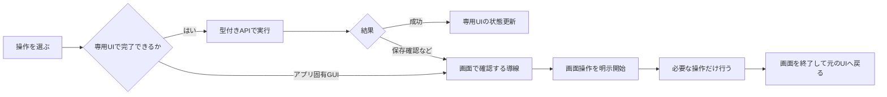

# スマホ専用UI案

画面の縮小表示から操作を始めず、「何をしたいか」から入る。アプリはウィンドウカード、ファイルは一覧と操作シート、文字入力はiPhoneの編集欄、PowerShellはコマンドと結果として表示する。

[静的UIプレビュー](ui-preview.html)は6画面のデザイン資料。表示内容はすべて例であり、Windowsへの接続・実行機能は持たない。

## 共通の構造

下部に **ホーム／アプリ／ファイル／端末／画面** の5タブ。上部にPC名と「接続済み」「再接続中」「PCがロック中」等の状態を表示する。文字入力は独立した常設タブにせず、ホームとアプリ／画面のツールバーから開く共通の入力シートにする。

主操作は親指の届く下半分へ置く。タップ領域は48 CSS pxを目標にし、少なくとも44 pxを確保する。基本本文は16 px以上、ラベルは日本語、アイコンだけに意味を任せない。iOSのsafe area、縦横回転、キーボード表示、大きい文字、VoiceOver、色に頼らない状態表示を検証する。ブラウザのズームを禁止しない。

初回だけ、PC側のセットアップに沿って証明書導入→PWA追加→PWA内で端末登録→アプリ専用パスフレーズで接続する。通常の画面に証明書やWebSocket等の実装用語を並べない。

## ホーム

```text
自宅PC                         接続済み
どの操作をしますか

[ Chromeを開く ]  [ メモ帳を開く ]
[ ファイルを見る ] [ 文字を送る   ]

開いているアプリ
Chrome     調べもの       [切り替え]
メモ帳     買い物メモ     [切り替え]

前回の作業
ドキュメント / Remote

ホーム   アプリ   ファイル   端末   画面
```

お気に入りはPCに登録した起動対象から選ぶ。最近使ったものは名前・場所へのリンクに留め、画面画像やクリップボード内容を自動収集しない。ウィンドウが閉じられていたら消し、古い操作対象に送信しない。

## アプリ

1枚のカードにアプリ名、ウィンドウタイトル、最小化／確認待ち等の状態、大きい「切り替え」ボタン、補助の「操作」ボタンを置く。アプリをひとまとめに終了せず、ウィンドウを単位にする。

「操作」シートには **文字を送る／通常終了／画面で見る**。通常終了で保存ダイアログが出た場合は「PCで保存の確認が必要です」と示して「画面で確認」へ進む。「閉じる」は即時強制終了を意味しない。

アプリ起動は登録済み一覧の検索から行う。MVPの検索は登録アプリ名と開いているウィンドウ名を対象にし、PC全体の任意コマンド検索にはしない。ブラウザのタブ一覧は将来拡張。

## ファイル

上部に登録ルートの切替、その下に短いパンくず、現在フォルダ内の検索欄、1列のファイル一覧。各行は名称・種類／サイズ・操作ボタンを持つ。長い名前は折り返し、拡張子や末尾を確認できる詳細シートを用意する。

タップはフォルダへ移動または詳細表示。「PCで開く」は別の明示操作で、許可された関連付けのみを使う。長押しは便利な補助に留め、すべての操作に可視ボタンを用意する。

ファイルの操作シート:

- 名前変更：元名と新名を並べる。衝突時は上書きしない。
- コピー／移動：移動先を選び、「ここへ移動」で確定。切り取り状態のままネットワークが切れても勝手に再開しない。
- ごみ箱へ：対象と件数を示す。ごみ箱非対応ならエラーにする。
- iPhoneへ保存：Safariのダウンロード／共有導線を使う。OS側の挙動を実機で確認する。
- iPhoneから追加：Filesのピッカーを利用し、選択内容・保存先・容量を確認する。

MVPは単一選択、1転送、同一登録ルート内の操作。複数選択や大量ファイルの同期は将来拡張。

## ターミナル

初期画面には「定型作業」と「PowerShell」を表示する。定型作業はPC側で定義した操作だけをボタン化する。自由なPowerShellは無効なら「PC側で利用を許可してください」と表示する。

PowerShellを開くと、上部にシェル名・作業フォルダ・残りの利用時間、中央に出力、下部に大きいコマンド入力欄と **実行**。補助キーは **Esc／Tab／Ctrl／↑／↓／←／→**。Ctrlは押下状態が見える一時トグルで、切断・画面移動時に解除する。

```text
PowerShell              残り 14分
作業場所: Remote

PS> Get-ChildItem
notes.txt
design.md

[ Get-Content .\notes.txt            ]
[Esc] [Tab] [Ctrl] [↑] [↓] [←] [→]
[中断 Ctrl+C]                [実行]
```

日本語入力は上の入力欄で変換確定後に送る。必要に応じて「対話入力」に切り替え、xterm.jsに直接接続する。生の対話入力では各キーや制御文字が直ちにシェルへ届くことを表示する。端末全体をスマホに合わせて不自然に折り返さず、端末の列数を調整し、元の出力形式を維持する。

複数行の貼付は実行前プレビューを出す。履歴は当該セッションのメモリ内だけに保持し、永続化しない。画面を隠しただけで長い処理が安全に継続するとは約束せず、切断時のセッション終了方針を表示する。

## 文字入力・コピー＆ペースト

共通入力シートの上部に送信先を大きく表示する。例: **メモ帳 — 買い物メモ**。iPhone標準キーボードで編集し、ユーザーが「文字を送る」を押した時だけ送信する。Enterは別ボタンとし、文字送信のついでに押さない。

送信先が閉じた／変わった場合は草稿を保持して送信を止め、対象の再選択を求める。パスワードや秘密を扱う専用の収集機能は作らない。草稿はメモリに限定し、ログアウト・失効で消す。

クリップボードは方向を明示する。

| 導線 | 動作 |
| --- | --- |
| iPhoneで貼り付け | ユーザーがiOSの貼付操作を行い、入力欄へ反映 |
| PCへコピー | 確認した文字列をPCのクリップボードへ置く。アプリへの貼付とは別 |
| PCへ貼り付け | クリップボード書換えと対象アプリへの貼付を明示して実行 |
| PCから取得 | PCの現在のテキストを画面上に取得。iPhoneのクリップボードはまだ変えない |
| iPhoneにコピー | 取得後の別タップでコピー。拒否された場合はテキスト選択の案内 |

Safariはユーザー操作と安全なコンテキストに制約があるため、取得の非同期処理とiPhoneへのコピーを分ける。[WebKit Clipboard API](https://webkit.org/blog/10855/async-clipboard-api/) 常時・双方向・バックグラウンド同期は行わない。

## 画面操作

通常は「画面転送は停止中」と「開始」だけ。開始時に再認証して、Windowsユーザー相当の画面操作を行うことを示す。終了ボタンは常に届く位置に置く。

表示中は、上部にWindows画面、中央にズーム／表示位置、下部に広いトラックパッドと **左クリック／右クリック／文字入力／終了**。標準は相対移動で、指が対象を覆わず小さいボタンも選べるようにする。

- 指1本：ポインター移動。クリックは専用ボタンまたはタップ。
- 指2本：スクロール。画面側のピンチ／パンとは操作領域を分ける。
- ドラッグ：明示的なドラッグ切替を利用し、押下状態を表示する。切断時は押しっぱなしを解除する。
- 直接タップ方式：オプションで切替。画像のズーム・余白・DPIを含めて座標を変換する。
- キーボード：独立した文字入力シートとEsc・Tab・Enter等の短い補助列。

MVPは1モニター、静止画に近い通常GUI作業を対象とする。動画・ゲーム・音声再生は目的にしない。画面から戻ればキャプチャを止める。

## 専用UIと画面操作の分岐



例: メモ帳を終了→保存確認が出る→アプリカードに確認待ち→画面を開始して保存→画面を終了。このとき「終了要求を受付」と「アプリが終了した」を混同しない。

## 状態・エラーの文言

| 状態 | 伝える内容 | 操作 |
| --- | --- | --- |
| 再接続中 | 接続を確認しています。まだ操作は送っていません | 送信ボタン無効。要求を自動再送しない |
| 外のネットワーク／到達不能 | 自宅Wi-FiとPCの起動状態を確認してください | 外部接続へ誘導しない。原因を断定しない |
| PCロック | PCでロックを解除してください | 接続再開は再認証後 |
| 証明書不備 | PC側で接続設定を確認してください | 証明書エラーを無視するボタンなし |
| 対象変更 | 送信先のアプリが変わりました | 草稿を保ち、対象再選択 |
| 前面化拒否 | このアプリは前面にできませんでした | 画面操作を開始する導線 |
| 応答不明 | 操作の結果を確認できません | 状態を確認。重複実行ボタンにしない |
| 権限不足 | この操作は現在のWindows権限では実行できません | 自動昇格しない |
| セッション失効 | 接続し直すにはパスフレーズが必要です | 端末登録を確認して再認証 |

## 代表的な体験の検証

1. ホームからメモ帳を起動し、日本語200文字を送り、必要な時だけEnterを送る。
2. Chromeとメモ帳の2ウィンドウを、画面転送せずカードで切り替える。
3. 登録フォルダのファイル名を変更し、別フォルダへコピーしてごみ箱へ移す。
4. PowerShellでファイルを一覧し、結果をiPhoneへ明示的にコピーする。
5. 保存ダイアログを画面操作で処理し、元のアプリカードへ戻る。
6. 入力途中でiPhoneをロックして戻る。対象を再確認し、二重入力しない。

各体験の合否とChromeリモートデスクトップとの比較条件は[検証計画](mvp-validation.md)で管理する。
